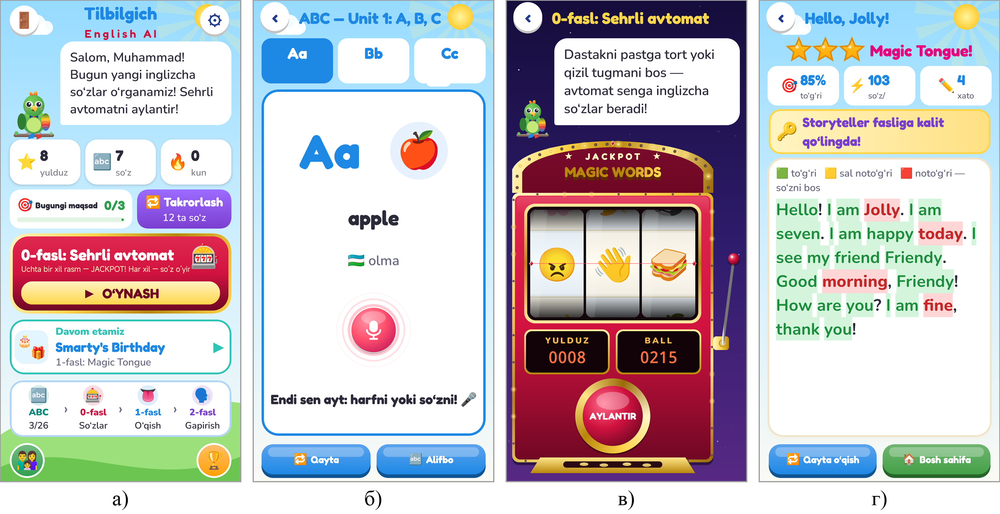
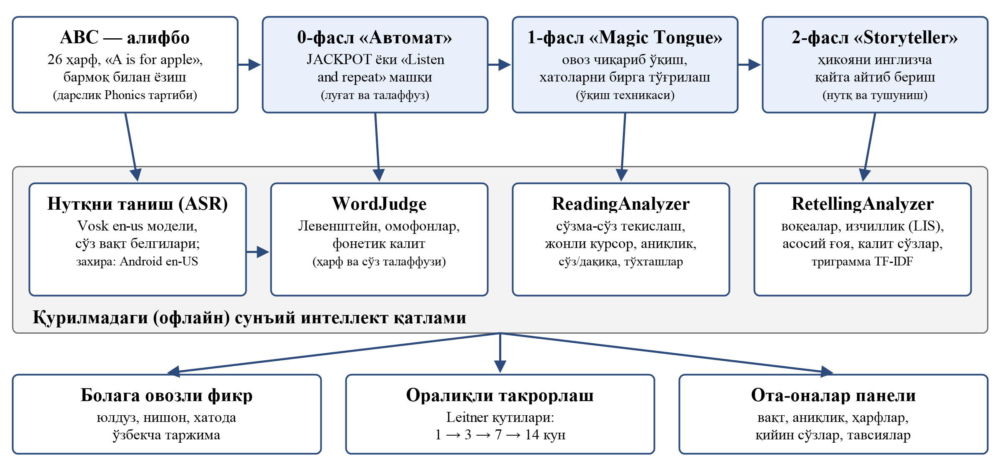

# 🇬🇧 Tilbilgich En AI

**Ingliz tili · 1–4-sinf · Android · o‘zbek tilida**

Ingliz tilini Tuti to‘tiqush bilan o‘rganing: alifbo, so‘zlar, o‘qish va gapirish — barcha ko‘rsatmalar o‘zbek tilida.

## Ilova haqida

«Tilbilgich En AI» — boshlang‘ich sinf o‘quvchilariga ingliz tilini o‘yin va sun'iy intellekt yordamida o‘rgatuvchi ilova. Barcha ko‘rsatmalar o‘zbek tilida, «Tuti» to‘tiqush ovozi bilan beriladi — to‘tiqush «Listen and repeat» g‘oyasining o‘zi. 26 harf, 130 so‘z va 40 hikoya 1-sinf «Ingliz tili» darsligi bo‘limlari tartibida. Talaffuz telefonda internetsiz baholanadi, xato so‘zlar bo‘g‘inlari, rasmi va tarjimasi bilan birga qaytariladi.

## Imkoniyatlar

- «Alifbo → so‘z → o‘qish → gapirish» to‘rt bosqichli izchil metodika
- 26 harf, 130 so‘z, 40 hikoya — milliy darslik tartibida
- «Sehrli avtomat»: uchta bir xil rasm — Jackpot! Har xil rasm — talaffuz mashqi
- Ovoz chiqarib o‘qish jonli baholanadi; inglizcha qayta hikoyalash (Storyteller)
- 20 daqiqadan keyin inglizcha buyruqlar bilan jismoniy tanaffus (TPR)
- Oraliqli takrorlash, kunlik seriya va ota-onalar paneli

## O‘yin ssenariysi

1. ABC — Tuti harfni va «A is for apple»ni aytadi, bola qaytaradi
2. 0-fasl «Sehrli avtomat» — so‘zlar va talaffuz
3. 1-fasl «Magic Tongue» — karaoke tinglash va ovoz chiqarib o‘qish
4. 2-fasl «Storyteller» — hikoyani inglizcha o‘z so‘zlari bilan aytish

## 🏆 Natija

Beshta analog bilan ekspert taqqoslashida **35 balldan 30 ball**.

## O‘rnatish

1. **[tilbilgich-en.apk](https://github.com/MSoqiy/tilbilgich-en/raw/main/apk/tilbilgich-en.apk)** faylini yuklab oling (APK papkasi — [apk/](https://github.com/MSoqiy/tilbilgich-en/tree/main/apk)).
2. Faylni oching; telefon so‘rasa, «Noma'lum manbalardan o‘rnatish»ga ruxsat bering.
3. «O‘rnatish»ni bosing. Birinchi ishga tushirishda ovoz modellari yuklanadi, keyin ilova internetsiz ishlaydi.

## Ekranlar

## English

**Tilbilgich En AI** — English for Uzbek-speaking kids: alphabet, words, reading and speaking with offline pronunciation scoring. Free, ad-free, works offline. Part of the *Aqlli o‘yin — bilimli avlod* (Smart games — knowledgeable generation) collection of Uzbek educational apps.

---

**Muallif:** Mamasaidov M.A. — Toshkent shahar Mirzo Ulug‘bek markazi o‘qituvchisi · Tetrasoft · ✉ soqiy65@gmail.com · 🌐 https://msoqiy.github.io

**Boshqa ilovalar:** [Otin buvi](https://github.com/MSoqiy/otin-buvi) · [Donish bobo](https://github.com/MSoqiy/donish-bobo) · [Bayon AI](https://github.com/MSoqiy/bayon-ai) · [Tilbilgich Fr AI](https://github.com/MSoqiy/tilbilgich-fr) · [Tilbilgich De AI](https://github.com/MSoqiy/tilbilgich-de) · [Tilbilgich Ar AI](https://github.com/MSoqiy/tilbilgich-ar) · [Aljabr](https://github.com/MSoqiy/aljabr) · [GeoSayyoh](https://github.com/MSoqiy/geosayyoh)

Kalit so‘zlar: ingliz tili bolalar uchun, ingliz tilini o‘rganish, english for kids uzbek, inglizcha so‘zlar, talaffuz, 1-sinf ingliz tili, ingliz alifbosi, английский для детей на узбекском языке, o‘zbekcha ta'limiy o‘yin, bolalar uchun ilova, android apk
